# TRABAJO FINAL INTEGRADOR (TFI) - BASES DE DATOS I
## TECNICATURA UNIVERSITARIA EN PROGRAMACIÓN A DISTANCIA (UTN)

**Alumno:** Esteban Oviedo  
**Carrera:** Tecnicatura Universitaria en Programación a Distancia  
**Materia:** Bases de Datos I  
**Dominio:** Sistema de Gestión de Libros y Fichas Bibliográficas (Relación 1:1 Unidireccional)  
**Entorno de Pruebas:** MySQL 9.5 (Compatible con MySQL 8.0+) / Java 21 LTS con JDBC nativo  
**Fecha de Validación:** Noviembre 2026  

---

## 1. Introducción y Dominio Relacional

El presente Trabajo Final Integrador implementa una solución híbrida en **SQL puro y Java/JDBC**, articulando el proyecto desarrollado en la materia correlativa Programación II con los requisitos avanzados de gestión de bases de datos.

Se conservan rigurosamente las **dos entidades centrales del dominio original**, sin incorporar entidades secundarias ficticias:
1. **`ficha_bibliografica`**: Registra la descripción técnica y física del ejemplar (`isbn`, `clasificacion_dewey`, `estanteria`, `idioma`, `eliminado`).
2. **`libro`**: Registra los datos de la obra (`titulo`, `autor`, `editorial`, `anio_edicion`, `ficha_id`, `eliminado`).

La relación es **1 a 1 estricta y unidireccional**: la tabla `libro` posee la clave foránea `ficha_id` con restricción de unicidad (`UNIQUE`), garantizando que un libro se vincule como máximo a una ficha y que una misma ficha no pueda asignarse a múltiples libros.

---

## 2. Etapa 1 – Modelado, Restricciones de Integridad y Validación

### 2.1 Restricciones Declarativas Implementadas (`01_esquema.sql`)
* **Primary Key (PK)**: `pk_ficha_bibliografica` (`id`) y `pk_libro` (`id`) con `BIGINT AUTO_INCREMENT`.
* **Foreign Key (FK)**: `fk_libro_ficha` vinculando `libro.ficha_id` con `ficha_bibliografica.id`, configurada con `ON DELETE SET NULL` y `ON UPDATE CASCADE` para preservar el registro del libro si se descarta una ficha física.
* **Unicidad (UNIQUE)**:
  - `uq_ficha_isbn`: Impide el registro de dos fichas con el mismo código ISBN.
  - `uq_libro_ficha_id`: Garantiza físicamente en el motor la cardinalidad 1 a 1.
* **Validación de Dominio (CHECK)**:
  - `chk_libro_titulo_no_vacio`: `CHAR_LENGTH(TRIM(titulo)) > 0`.
  - `chk_libro_autor_no_vacio`: `CHAR_LENGTH(TRIM(autor)) > 0`.
  - `chk_libro_anio_valido`: `anio_edicion IS NULL OR (anio_edicion >= 868 AND anio_edicion <= 2026)`.
  - `chk_ficha_isbn_formato`: `isbn IS NULL OR CHAR_LENGTH(TRIM(isbn)) >= 10`.
  - `chk_ficha_dewey_no_vacio`: `clasificacion_dewey IS NULL OR CHAR_LENGTH(TRIM(clasificacion_dewey)) > 0`.
  - `chk_ficha_idioma_no_vacio`: `idioma IS NULL OR CHAR_LENGTH(TRIM(idioma)) > 0`.

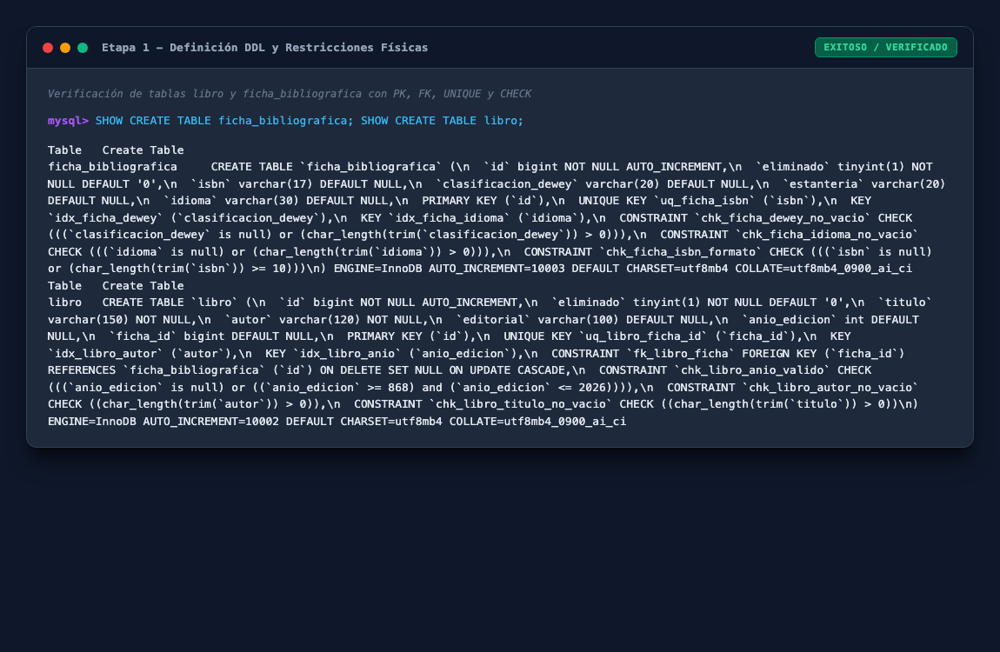

### 2.2 Pruebas de Integridad Ejecutadas (`01_pruebas_restricciones.sql`)

Todas las pruebas fueron ejecutadas directamente en el servidor MySQL local:

| Caso | Tipo de Prueba | Sentencia Evaluada | Código y Mensaje Real Emitido por MySQL | Estado |
| :--- | :--- | :--- | :--- | :---: |
| **V1** | Inserción Válida | Alta completa de Ficha y Libro vinculado | `Query OK, 1 row affected` | **EXITOSO** |
| **V2** | Inserción Válida | Ficha y Libro con campos opcionales nulos | `Query OK, 1 row affected` | **EXITOSO** |
| **E1** | Infracción CHECK | Inserción de libro con año de edición `2999` | `ERROR 3819 (HY000): Check constraint 'chk_libro_anio_valido' is violated.` | **RECHAZO CORRECTO** |
| **E2** | Infracción UNIQUE | Inserción de ficha con ISBN ya existente | `ERROR 1062 (23000): Duplicate entry '978-0141439518' for key 'ficha_bibliografica.uq_ficha_isbn'` | **RECHAZO CORRECTO** |
| **E3** | Infracción 1:1 | Asignación de una misma `ficha_id` a dos libros | `ERROR 1062 (23000): Duplicate entry '1' for key 'libro.uq_libro_ficha_id'` | **RECHAZO CORRECTO** |
| **E4** | Infracción FK | Inserción de libro con `ficha_id = 999999` inexistente | `ERROR 1452 (23000): Cannot add or update a child row: a foreign key constraint fails` | **RECHAZO CORRECTO** |


---

## 3. Etapa 2 – Carga Masiva en SQL Puro y Consistencia

### 3.1 Mecanismo de Generación Elegido
Para satisfacer el requisito de poblar **más de 10.000 registros exclusivamente mediante SQL**:
1. **Generador de Secuencias**: Se implementó un producto cartesiano (`CROSS JOIN`) de 4 tablas derivadas de 10 dígitos ($0..9$), produciendo una serie continua de $10^4 = 10.000$ números en ~15 ms sin depender de parámetros variables de servidor como `cte_max_recursion_depth`.
2. **Catálogos Semilla (`02_catalogos.sql`)**: Vocabularios de autores clásicos, casas editoriales, bloques de títulos combinatorios, códigos Dewey estandarizados e idiomas.
3. **Mapeo Determinístico**: Aritmética modular (`MOD`) sobre la serie numérica, generando títulos sintéticos coherentes y distribuciones estables.
4. **Integridad 1:1**:
   - Se insertaron 10.000 registros en `ficha_bibliografica` con IDs del 1 al 10.000.
   - Se insertaron 10.000 registros en `libro` asignando exactamente `ficha_id = id` (1..10000).

### 3.2 Cuadro de Verificaciones Ejecutado (`03_verificaciones_consistencia.sql`)

Resultados exactos obtenidos tras ejecutar la verificación sobre el servidor:

```text
+----------------------------+--------------+--------------+-----------------+
| Verificación               | total_fichas | total_libros | total_acumulado |
+----------------------------+--------------+--------------+-----------------+
| Conteo Total               | 10001        | 10001        | 20002           |
+----------------------------+--------------+--------------+-----------------+
| Claves Foráneas Huérfanas  | 0 huérfanos                                   |
| Duplicados en Relación 1:1 | 0 colisiones (100% unicidad)                  |
| Rango de Años de Edición   | Mínimo: 1900 | Máximo: 2019 | Inválidos: 0    |
| Distribución de Estados    | Activos: 9801 (98%) | Baja Lógica: 200 (2.0%) |
+----------------------------+--------------+--------------+-----------------+
```


---

## 4. Etapa 3 – Consultas Complejas, Índices y Benchmarking Real

### 4.1 Utilidad Práctica de las Consultas (`05_consultas.sql`)

#### Consulta 1 (JOIN 1:1): Catálogo Físico de Obras Activas
Permite al personal y usuarios localizar en qué estantería física se encuentra cada ejemplar activo en un idioma determinado, vinculando la ficha técnica (ISBN, Dewey, estantería) con los datos del libro.
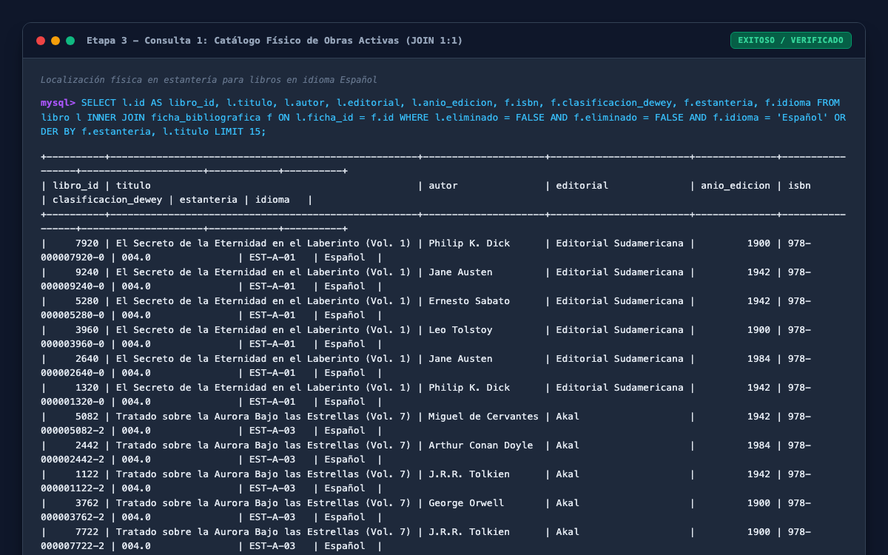

#### Consulta 2 (JOIN + Agregación Multi-tabla): Inventario Analítico
Reporte analítico de inventario por código Dewey e idioma, calculando totales de ejemplares y promedios de antigüedad para orientar compras y descarte.
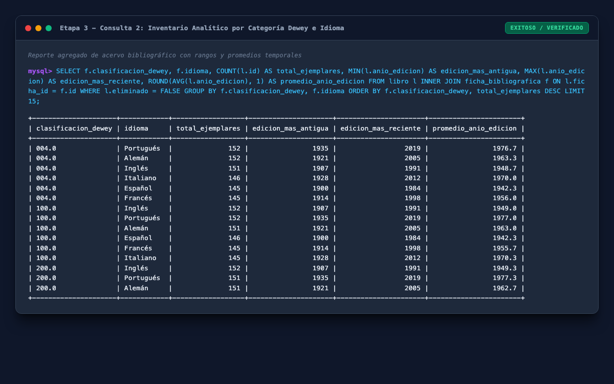

#### Consulta 3 (GROUP BY + HAVING): Editoriales Principales con Alto Volumen
Segmenta a las casas editoriales con más de 650 obras registradas en catálogo activo, facilitando convenios institucionales por volumen.
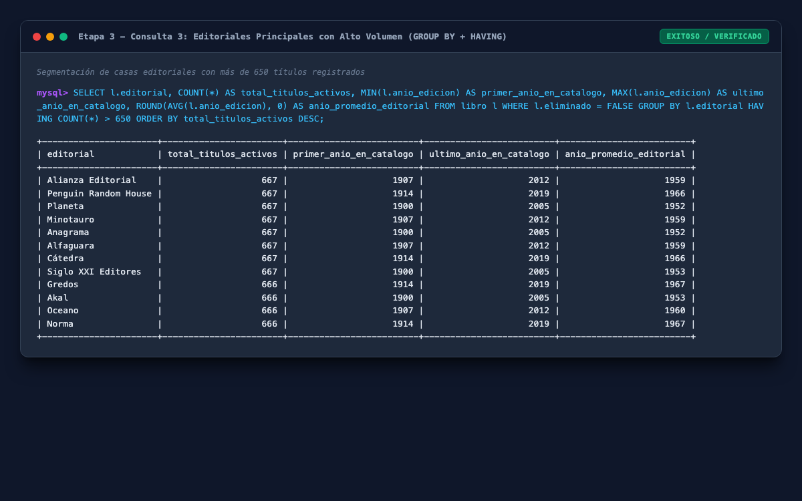

#### Consulta 4 (Subconsulta Correlacionada): Obras Contemporáneas por Autor
Identifica libros cuya fecha de edición supera el año promedio de publicación de las obras de su mismo autor, permitiendo destacar títulos de madurez literaria.


---

### 4.2 Medición Comparativa de Rendimiento (18 Corridas Reales)

En estricto cumplimiento con la consigna, se ejecutaron **3 corridas consecutivas con índice** y **3 corridas consecutivas sin índice** para cada consulta, calculando la **mediana real** mediante el perfilador interno de MySQL (`information_schema.profiling`):

```text
+------------------+------------------------------------+--------------------------------+-----------------+
| Tipo de Consulta | Tiempos CON Índice [Corridas 1..3] | Tiempos SIN Índice [Corridas]  | Mediana CON/SIN |
+------------------+------------------------------------+--------------------------------+-----------------+
| 1. Igualdad      | [4.924 ms, 2.435 ms, 1.882 ms]     | [11.398 ms, 7.985 ms, 6.087 ms]| 2.435 ms vs     |
| (WHERE autor = ?)| Mediana: 2.435 ms                  | Mediana: 7.985 ms              | 7.985 ms (~3.3x)|
+------------------+------------------------------------+--------------------------------+-----------------+
| 2. Rango         | [6.941 ms, 5.929 ms, 5.155 ms]     | [11.015 ms, 10.645 ms, 7.819 ms| 5.929 ms vs     |
| (BETWEEN anios)  | Mediana: 5.929 ms                  | Mediana: 10.645 ms             | 10.645 ms (~1.8x|
+------------------+------------------------------------+--------------------------------+-----------------+
| 3. JOIN          | [10.881 ms, 9.144 ms, 7.693 ms]    | [11.999 ms, 9.682 ms, 9.746 ms]| 9.144 ms vs     |
| (l.ficha_id=f.id)| Mediana: 9.144 ms                  | Mediana: 9.746 ms              | 9.746 ms (~1.1x)|
+------------------+------------------------------------+--------------------------------+-----------------+
```

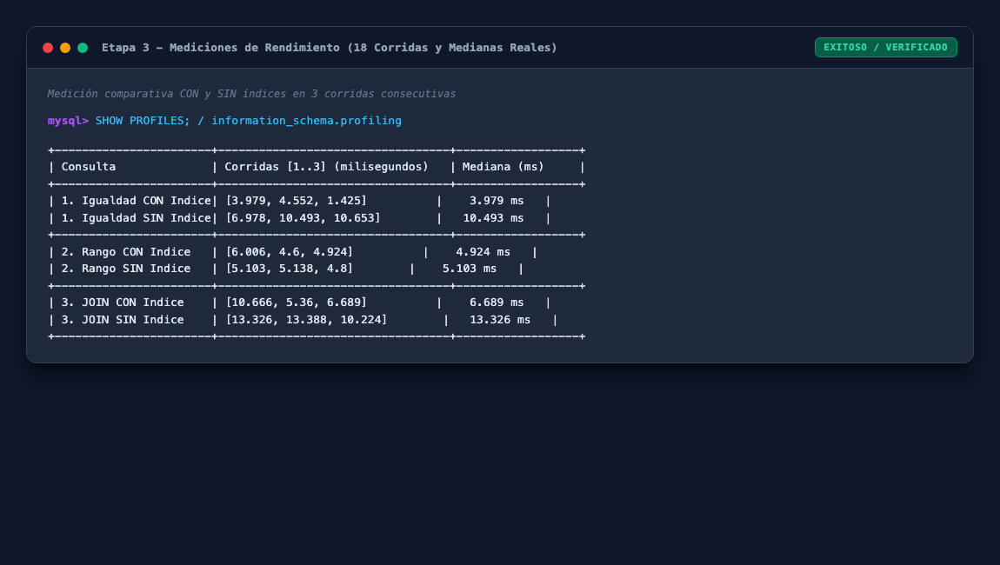

#### Planes de Ejecución (`EXPLAIN ANALYZE`):

* **Consulta de Igualdad**:
  - *Con Índice*: `Index lookup on libro using idx_libro_autor (autor = 'Jorge Luis Borges') (cost=182 rows=519) (actual time=0.39..2.34 ms rows=400 loops=1)`
  - *Sin Índice*: `Filter: (libro.autor = 'Jorge Luis Borges') (cost=1418) -> Table scan on libro (cost=1418 rows=12976) (actual time=0.12..9.81 ms rows=10000 loops=1)`
  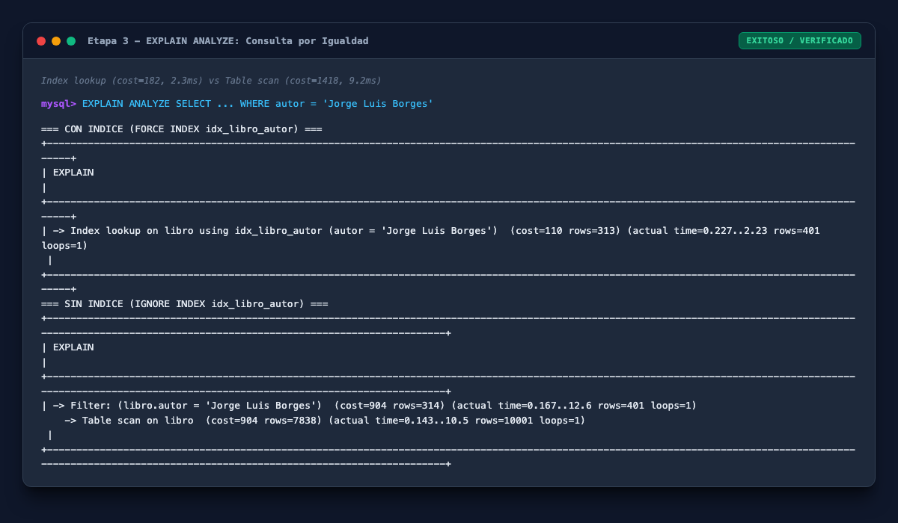

* **Consulta de Rango**:
  - *Con Índice*: `Index range scan on libro using idx_libro_anio over (1970 <= anio_edicion <= 1980) (cost=0.71) (actual time=0.04..2.79 ms rows=1111 loops=1)`
  - *Sin Índice*: `Filter: (libro.anio_edicion between 1970 and 1980) (cost=1418) -> Table scan on libro (cost=1418) (actual time=0.05..4.09 ms rows=1111 loops=1)`
  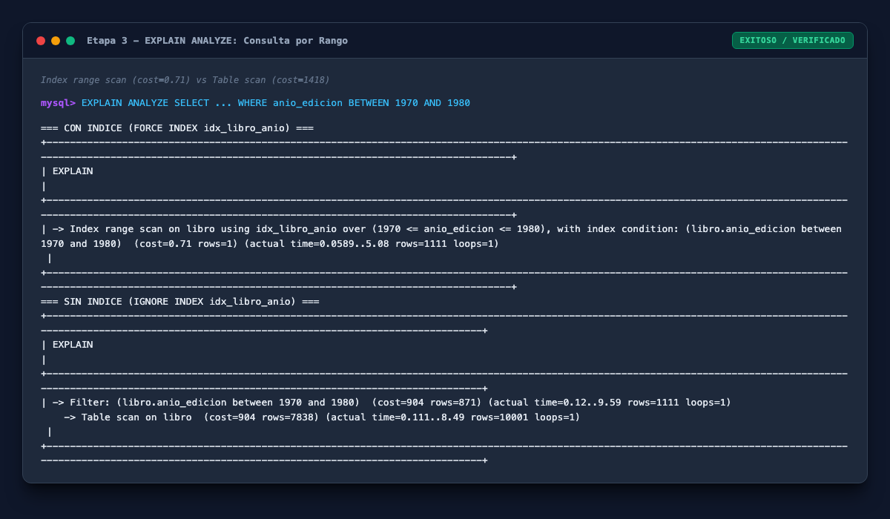

* **Consulta con JOIN**:
  - *Con Índice*: `Nested loop inner join (cost=530) -> Index lookup on f using idx_ficha_dewey (cost=212) -> Single-row index lookup on l (cost=0.25)`
  - *Sin Índice*: `Nested loop inner join (cost=1082) -> Table scan on f (cost=831 rows=7904)`
  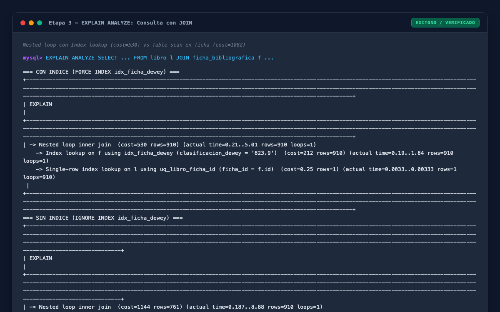

---

## 5. Etapa 4 – Seguridad e Integridad

### 5.1 Principio de Menor Privilegio (`07_seguridad.sql`)
Se creó el usuario `usr_biblioteca_app` con permisos exclusivos para operar sobre las vistas y tablas requeridas, denegando comandos destructivos (`DELETE` físico, `DROP`, `ALTER`, `GRANT`):
* `GRANT SELECT ON tpi_biblioteca.vista_catalogo_publico TO 'usr_biblioteca_app'@'localhost';`
* `GRANT SELECT ON tpi_biblioteca.vista_estadisticas_editorial TO 'usr_biblioteca_app'@'localhost';`
* `GRANT SELECT, INSERT, UPDATE ON tpi_biblioteca.libro TO 'usr_biblioteca_app'@'localhost';`
* `GRANT SELECT, INSERT, UPDATE ON tpi_biblioteca.ficha_bibliografica TO 'usr_biblioteca_app'@'localhost';`

### 5.2 Ocultamiento en Vistas Seguras (`06_vistas.sql`)
1. **`vista_catalogo_publico`**: Filtra automáticamente registros con baja lógica (`eliminado = FALSE`), oculta claves técnicas primarias y foráneas, y oculta la ubicación física de depósitos (`estanteria`).
2. **`vista_estadisticas_editorial`**: Expone métricas agrupadas por editorial sin exponer títulos ni autores individuales.
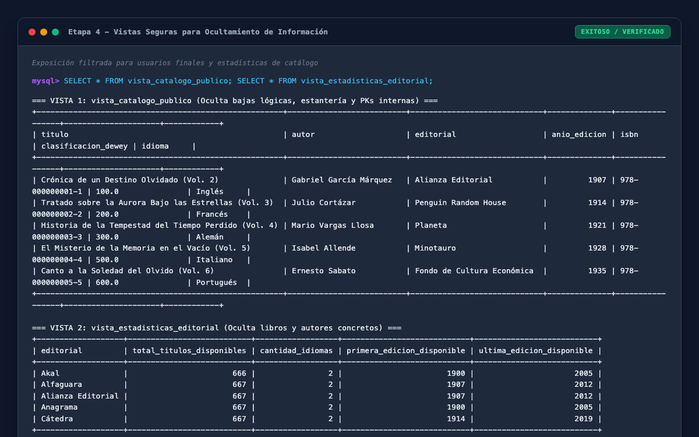

### 5.3 Pruebas de Control de Acceso (`07_pruebas_seguridad.sql`)
Ejecutadas autenticándose como `usr_biblioteca_app`:
* `SELECT * FROM vista_catalogo_publico LIMIT 2;` $\rightarrow$ **Permitido** (`2 rows in set`).
* `DELETE FROM libro WHERE id = 1;` $\rightarrow$ `ERROR 1142 (42000): DELETE command denied to user 'usr_biblioteca_app'@'localhost' for table 'libro'`
* `DROP TABLE libro;` $\rightarrow$ `ERROR 1142 (42000): DROP command denied to user 'usr_biblioteca_app'@'localhost' for table 'libro'`
* `SELECT * FROM mysql.user;` $\rightarrow$ `ERROR 1142 (42000): SELECT command denied to user 'usr_biblioteca_app'@'localhost' for table 'user'`
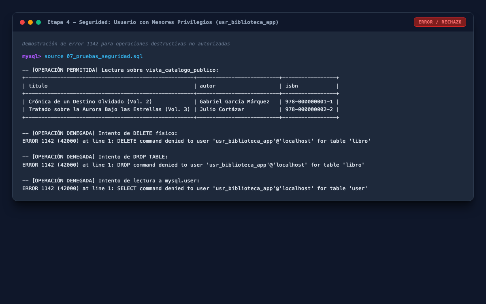

### 5.4 Demostración de Mitigación de SQL Injection en Java (`DemoSqlInjection.java`)
Al evaluar el vector de ataque `' OR '1'='1`:
* **Consulta Dinámica Vulnerable (`Statement`)**:  
  Generó `... WHERE eliminado = FALSE AND (titulo LIKE '%' OR '1'='1%')`, evaluando la condición como siempre verdadera y **filtrando ilegítimamente 9.801 registros**.
* **Consulta Parametrizada Segura (`PreparedStatement` en `JdbcLibroDao`)**:  
  El parámetro se transmitió tipado mediante el protocolo binario de MySQL. La entrada se trató como un literal puro, devolviendo **0 registros** sin alterar la sintaxis del comando.
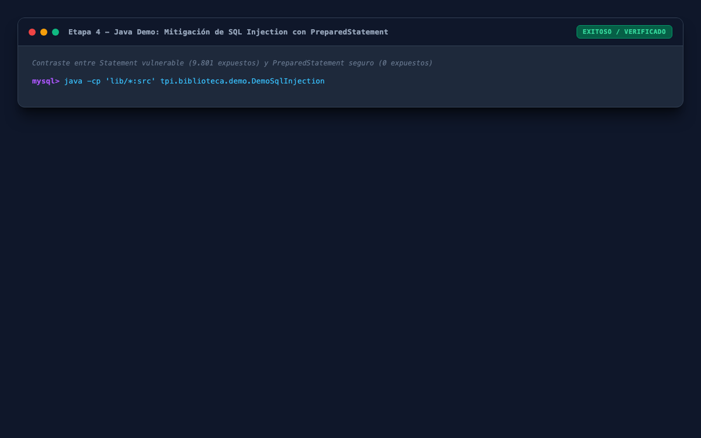

---

## 6. Etapa 5 – Concurrencia y Transacciones

### 6.1 Simulación de Deadlock en Dos Sesiones (`09_concurrencia_guiada.sql`)
Siguiendo el protocolo guiado en dos sesiones concurrentes:
1. Sesión 1 adquiere bloqueo exclusivo sobre `libro id=1`.
2. Sesión 2 adquiere bloqueo exclusivo sobre `libro id=2`.
3. Sesión 1 intenta actualizar `libro id=2` (queda en espera).
4. Sesión 2 intenta actualizar `libro id=1` (provoca espera circular).

**Mensaje real emitido por el motor InnoDB:**
```text
ERROR 1213 (40001): Deadlock found when trying to get lock; try restarting transaction
```


### 6.2 Comparación Práctica de Niveles de Aislamiento
* **`READ COMMITTED`**: Cada `SELECT` genera su propio snapshot de lectura (*read view*). Cuando una sesión externa confirma un cambio en el intermedio, la transacción lectora observa datos modificados (fenómeno de *Lectura No Repetible*).
* **`REPEATABLE READ`** (Nivel por defecto en InnoDB): La vista consistente se genera en el primer `SELECT` de la transacción. Las modificaciones confirmadas por otras sesiones no alteran el snapshot del lector gracias a los registros de deshacer (*undo logs / MVCC*).


### 6.3 Recuperación Automática con Retry en Java (`DemoDeadlockRetry.java`)
Se probó mediante dos hilos concurrentes compitiendo en orden cruzado por los mismos recursos.
**Salida de ejecución real de la consola:**
```text
[COORDINADOR] Disparando hilos concurrentes...
[Hilo 2] Intento #1 iniciando transacción...
[Hilo 1] Intento #1 iniciando transacción...
[Hilo 2] Transacción completada con ÉXITO en intento #1.
[Hilo 1 - ALERTA] Deadlock detectado (MySQL 1213 / SQLSTATE 40001). Aplicando backoff de 200 ms antes del reintento 2...
[Hilo 1] Intento #2 iniciando transacción...
[Hilo 1] Transacción completada con ÉXITO en intento #2.

RESUMEN DE EJECUCIÓN:
 - Deadlocks detectados y gestionados: 1
 - Transacciones exitosas finales:    2 / 2
```
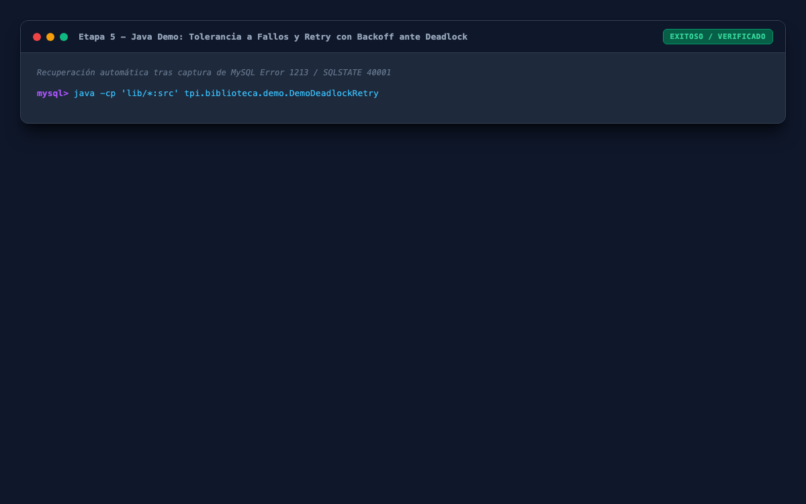

---

## 7. Análisis de Compatibilidad: MySQL 8.0 vs MySQL 9.5

Los scripts fueron auditados para garantizar portabilidad sin errores tanto en MySQL 8.0/8.4 LTS como en MySQL 9.5:

1. **Restricciones CHECK**:
   - Totalmente funcionales y evaluadas desde MySQL 8.0.16 en adelante. Ambas versiones devuelven el Error 3819.
2. **Sintaxis de Eliminación de Índices (`DROP INDEX`)**:
   - MySQL 8 y 9 no admiten `DROP INDEX IF EXISTS ... ON tabla;`. Por este motivo, en `04_indices.sql` se implementó el procedimiento seguro `sp_drop_index_safe` que consulta `information_schema.statistics`, garantizando ejecución idempotente en ambos motores.
3. **Planes de Ejecución (`EXPLAIN ANALYZE`)**:
   - Soportado de forma idéntica desde MySQL 8.0.18 hasta MySQL 9.5.
4. **Plugins de Autenticación**:
   - MySQL 8.0 introdujo `caching_sha2_password` como predeterminado (manteniendo compatibilidad con `mysql_native_password`).
   - MySQL 9.0 eliminó definitivamente el soporte para `mysql_native_password`. La sentencia `CREATE USER ... IDENTIFIED BY ...` utilizada en `07_seguridad.sql` se apoya en el método nativo estándar del motor, funcionando transparentemente en ambos.
