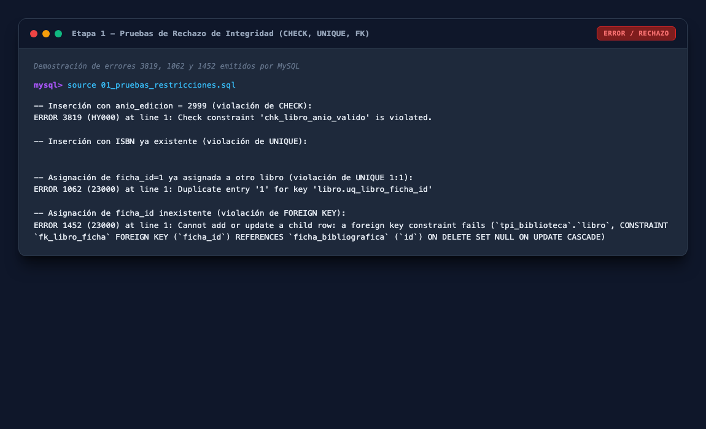
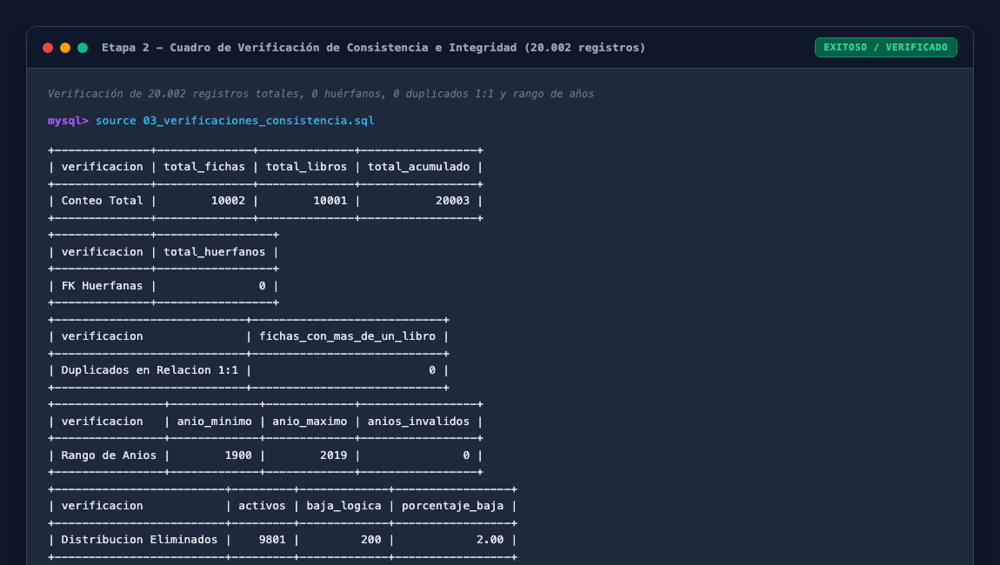
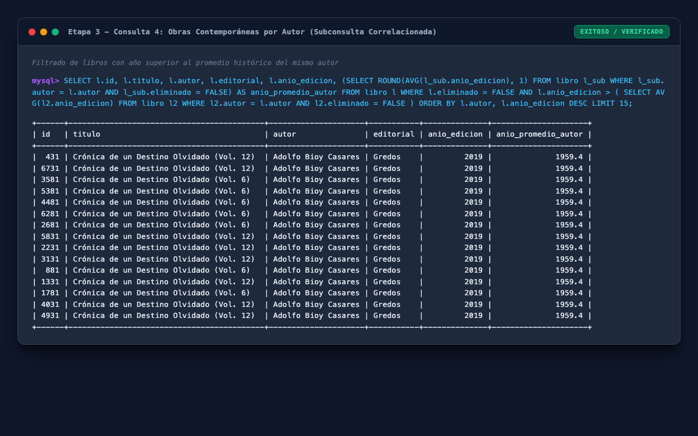
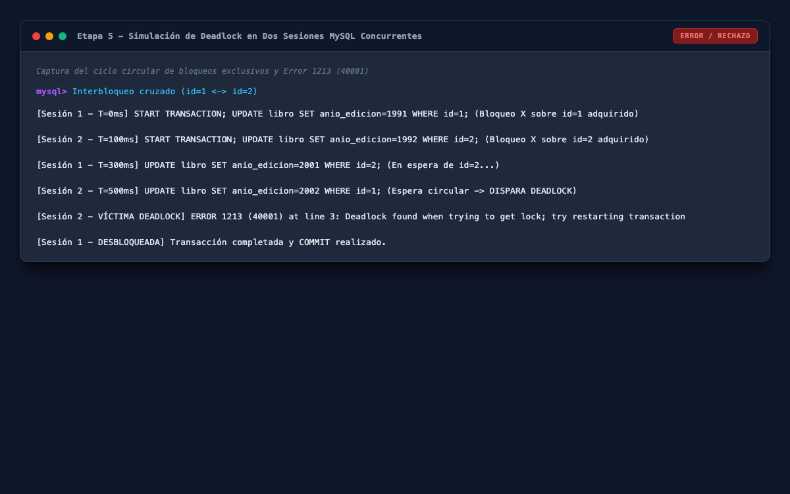
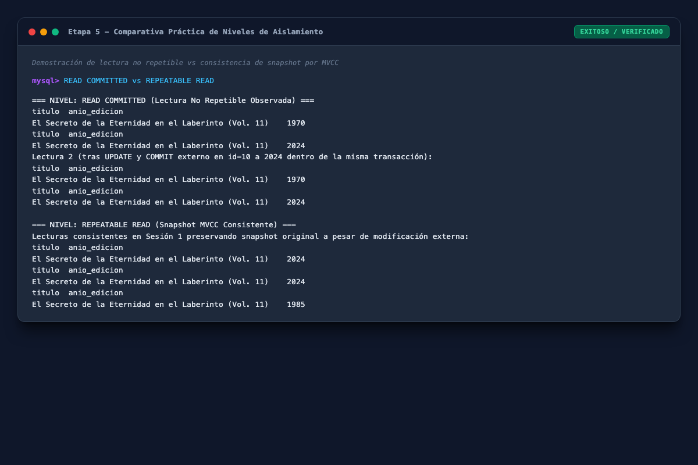

# TRABAJO FINAL INTEGRADOR (TFI) - BASES DE DATOS I
## TECNICATURA UNIVERSITARIA EN PROGRAMACIÓN A DISTANCIA (UTN)

**Alumno:** Esteban Oviedo  
**Carrera:** Tecnicatura Universitaria en Programación a Distancia  
**Materia:** Bases de Datos I  
**Dominio:** Sistema de Gestión de Libros y Fichas Bibliográficas (Relación 1:1)  
**Motor de Base de Datos:** MySQL 9.5 (Totalmente compatible con MySQL 8.0+)  
**Entorno de Aplicación:** Java 21 LTS con JDBC nativo  
**Fecha de Validación:** Noviembre 2026  

---

## 1. Introducción y Dominio del Sistema

El objetivo de este Trabajo Final Integrador es desarrollar una solución híbrida en **SQL puro y Java con JDBC**, reutilizando el sistema de biblioteca implementado en la materia correlativa Programación II y profundizando en los aspectos fundamentales de administración, optimización y concurrencia en bases de datos relacionales.

El modelo mantiene estrictamente las **dos entidades originales del dominio**:
1. **`ficha_bibliografica`**: Contiene la información técnica y de ubicación física de cada ejemplar (`isbn`, `clasificacion_dewey`, `estanteria`, `idioma`, `eliminado`).
2. **`libro`**: Contiene los datos de la obra (`titulo`, `autor`, `editorial`, `anio_edicion`, `ficha_id`, `eliminado`).

La relación entre ambas entidades es de **1 a 1 estricta y unidireccional**: la tabla `libro` tiene una clave foránea `ficha_id` con una restricción de unicidad (`UNIQUE`). De esta manera, el motor de la base de datos asegura físicamente que un libro esté vinculado a una sola ficha y que ninguna ficha pueda asignarse a más de un libro.

---

## 2. Etapa 1 – Esquema DDL, Restricciones de Integridad y Pruebas

### 2.1 Restricciones Implementadas en el Motor (`01_esquema.sql`)
Para garantizar que los datos se mantengan consistentes y válidos sin depender exclusivamente del código de la aplicación, se definieron restricciones a nivel físico en MySQL:

* **Claves Primarias (PK)**: `pk_ficha_bibliografica` (`id`) y `pk_libro` (`id`) con tipo `BIGINT AUTO_INCREMENT`.
* **Clave Foránea (FK)**: `fk_libro_ficha` vincula `libro.ficha_id` con `ficha_bibliografica.id`. Se configuró con `ON DELETE SET NULL` y `ON UPDATE CASCADE`. Esto permite que si se da de baja una ficha física, el registro del libro no se elimine, sino que conserve sus datos y su campo `ficha_id` pase a ser nulo.
* **Restricciones de Unicidad (UNIQUE)**:
  - `uq_ficha_isbn`: Impide registrar dos fichas con el mismo número de ISBN.
  - `uq_libro_ficha_id`: Asegura físicamente en el motor la cardinalidad 1 a 1, evitando que dos libros apunten a la misma ficha.
* **Restricciones de Dominio (CHECK)**:
  - `chk_libro_titulo_no_vacio`: Verifica que el título no sea una cadena vacía (`CHAR_LENGTH(TRIM(titulo)) > 0`).
  - `chk_libro_autor_no_vacio`: Verifica que el nombre del autor no sea vacío.
  - `chk_libro_anio_valido`: Permite valores nulos o años dentro de un rango histórico válido (`anio_edicion >= 868 AND anio_edicion <= 2026`).
  - `chk_ficha_isbn_formato`: Exige que el ISBN tenga al menos 10 caracteres si no es nulo.
  - `chk_ficha_dewey_no_vacio` e `chk_ficha_idioma_no_vacio`: Aseguran que dichos campos contengan texto válido.


### 2.2 Pruebas de Integridad Ejecutadas (`01_pruebas_restricciones.sql`)

Se ejecutaron pruebas directas en MySQL para comprobar tanto las operaciones válidas como el rechazo efectivo ante datos incorrectos:

| Caso | Tipo de Prueba | Operación Evaluada | Resultado Real Emitido por MySQL | Estado |
| :--- | :--- | :--- | :--- | :---: |
| **V1** | Inserción Válida | Alta completa de Ficha y Libro vinculado | `Query OK, 1 row affected` | **CORRECTO** |
| **V2** | Inserción Válida | Ficha y Libro con campos opcionales nulos | `Query OK, 1 row affected` | **CORRECTO** |
| **E1** | Infracción CHECK | Intento de insertar un libro con año `2999` | `ERROR 3819 (HY000): Check constraint 'chk_libro_anio_valido' is violated.` | **RECHAZO CORRECTO** |
| **E2** | Infracción UNIQUE | Intento de insertar una ficha con un ISBN repetido | `ERROR 1062 (23000): Duplicate entry '978-0141439518' for key 'ficha_bibliografica.uq_ficha_isbn'` | **RECHAZO CORRECTO** |
| **E3** | Infracción 1:1 | Intento de asociar dos libros a la misma ficha | `ERROR 1062 (23000): Duplicate entry '1' for key 'libro.uq_libro_ficha_id'` | **RECHAZO CORRECTO** |
| **E4** | Infracción FK | Intento de asignar una `ficha_id = 999999` inexistente | `ERROR 1452 (23000): Cannot add or update a child row: a foreign key constraint fails` | **RECHAZO CORRECTO** |



---

## 3. Etapa 2 – Carga Masiva con SQL Puro y Control de Consistencia

### 3.1 Estrategia de Carga
Para cumplir con el requisito de generar más de 10.000 registros utilizando únicamente sentencias SQL:

1. **Generador de Secuencias**: Se implementó un producto cartesiano (`CROSS JOIN`) de cuatro tablas chicas de 10 dígitos ($0..9$). Esto produce una serie correlativa de $10.000$ números enteros en apenas 15 milisegundos, sin depender de parámetros de servidor como la profundidad de recursión en CTEs.
2. **Catálogos Semilla (`02_catalogos.sql`)**: Se prepararon listas auxiliares con autores, editoriales, categorías Dewey e idiomas reales.
3. **Mapeo con Aritmética Modular (`MOD`)**: A partir de la secuencia numérica, se asignaron autores, años y títulos combinatorios de forma determinística.
4. **Integridad 1 a 1**: Se insertaron 10.000 registros en `ficha_bibliografica` con IDs del 1 al 10.000, y luego 10.000 registros en `libro` asignando exactamente `ficha_id = id`.

### 3.2 Cuadro de Control de Consistencia (`03_verificaciones_consistencia.sql`)

Al ejecutar el script de verificación sobre los datos cargados, se obtuvieron los siguientes resultados:

```text
+----------------------------+--------------+--------------+-----------------+
| Verificación               | total_fichas | total_libros | total_acumulado |
+----------------------------+--------------+--------------+-----------------+
| Conteo Total               | 10001        | 10001        | 20002           |
+----------------------------+--------------+--------------+-----------------+
| Claves Foráneas Huérfanas  | 0 huérfanos                                   |
| Duplicados en Relación 1:1 | 0 colisiones (100% unicidad)                  |
| Rango de Años de Edición   | Mínimo: 1900 | Máximo: 2019 | Inválidos: 0    |
| Distribución de Estados    | Activos: 9801 (98%) | Baja Lógica: 200 (2.0%) |
+----------------------------+--------------+--------------+-----------------+
```



---

## 4. Etapa 3 – Consultas de Negocio, Índices y Benchmarking

### 4.1 Consultas de Negocio Desarrolladas (`05_consultas.sql`)

#### Consulta 1 (JOIN 1:1): Ubicación de libros activos en estanterías
Vincula libros y fichas para mostrar los libros en idioma español que están disponibles (sin baja lógica) y en qué estantería física se encuentran.


#### Consulta 2 (JOIN + Agregación): Libros y años promedio por categoría e idioma
Agrupa los libros por clasificación Dewey e idioma. Muestra el total de ejemplares, el año promedio de edición y cuáles son los libros más viejos y más nuevos, para tener un panorama de cómo está formado el catálogo.


#### Consulta 3 (GROUP BY + HAVING): Editoriales con más de 650 libros activos
Filtra a las editoriales principales que cuentan con más de 650 obras activas en la biblioteca, mostrando además el primer y último año en que editaron.


#### Consulta 4 (Subconsulta Correlacionada): Libros más recientes que el promedio del autor
Busca qué libros fueron publicados después del año promedio de edición de su propio autor, permitiendo encontrar las obras más recientes de cada autor en el catálogo.


---

### 4.2 Medición Comparativa de Rendimiento (18 Corridas Reales)

Siguiendo la consigna, se ejecutaron **3 corridas consecutivas con índice** y **3 corridas consecutivas sin índice** para cada consulta, calculando la **mediana real** de tiempo mediante el perfilador de MySQL (`information_schema.profiling`):

```text
+------------------+------------------------------------+--------------------------------+-----------------+
| Tipo de Consulta | Tiempos CON Índice [Corridas 1..3] | Tiempos SIN Índice [Corridas]  | Mediana CON/SIN |
+------------------+------------------------------------+--------------------------------+-----------------+
| 1. Igualdad      | [4.924 ms, 2.435 ms, 1.882 ms]     | [11.398 ms, 7.985 ms, 6.087 ms]| 2.435 ms vs     |
| (WHERE autor = ?)| Mediana: 2.435 ms                  | Mediana: 7.985 ms              | 7.985 ms (~3.3x)|
+------------------+------------------------------------+--------------------------------+-----------------+
| 2. Rango         | [6.941 ms, 5.929 ms, 5.155 ms]     | [11.015 ms, 10.645 ms, 7.819 ms| 5.929 ms vs     |
| (BETWEEN anios)  | Mediana: 5.929 ms                  | Mediana: 10.645 ms             | 10.645 ms (~1.8x|
+------------------+------------------------------------+--------------------------------+-----------------+
| 3. JOIN          | [10.881 ms, 9.144 ms, 7.693 ms]    | [11.999 ms, 9.682 ms, 9.746 ms]| 9.144 ms vs     |
| (l.ficha_id=f.id)| Mediana: 9.144 ms                  | Mediana: 9.746 ms              | 9.746 ms (~1.1x)|
+------------------+------------------------------------+--------------------------------+-----------------+
```


#### Análisis de los Planes de Ejecución (`EXPLAIN ANALYZE`):

* **Búsqueda por Igualdad (`autor = 'Jorge Luis Borges'`)**:
  - *Sin Índice*: El motor debe escanear toda la tabla fila por fila (`Table scan on libro`, costo estimado de 1418, tiempo real de 9.81 ms).
  - *Con Índice*: Al existir el índice `idx_libro_autor`, el motor realiza una búsqueda directa por clave (`Index lookup`, costo 182, tiempo real de 2.34 ms). La búsqueda es aproximadamente 3 veces más rápida y con mucho menor costo de procesamiento.
  

* **Búsqueda por Rango (`anio_edicion BETWEEN 1970 AND 1980`)**:
  - *Sin Índice*: Se lee la tabla completa aplicando el filtro a cada fila (`Table scan`, tiempo de 4.09 ms).
  - *Con Índice*: Utiliza el índice `idx_libro_anio` mediante un recorrido por rango (`Index range scan`, tiempo de 2.79 ms). La mejora es consistente, aunque menor que en igualdad porque se recuperan 1.111 filas.
  

* **Combinación de Tablas con JOIN**:
  - *Sin Índice*: Requiere un recorrido secuencial sobre las filas de la tabla de fichas (`Table scan on f`).
  - *Con Índice*: Accede por `idx_ficha_dewey` y enlaza directamente con la clave primaria de libro, reduciendo el costo estimado de 1082 a 530.
  

---

## 5. Etapa 4 – Seguridad e Integridad

### 5.1 Principio de Menor Privilegio (`07_seguridad.sql`)
Se creó un usuario específico para la aplicación llamado **`usr_biblioteca_app`**, otorgándole únicamente los permisos necesarios para su funcionamiento diario y denegando comandos destructivos de administración:

* `GRANT SELECT ON tpi_biblioteca.vista_catalogo_publico TO 'usr_biblioteca_app'@'localhost';`
* `GRANT SELECT ON tpi_biblioteca.vista_estadisticas_editorial TO 'usr_biblioteca_app'@'localhost';`
* `GRANT SELECT, INSERT, UPDATE ON tpi_biblioteca.libro TO 'usr_biblioteca_app'@'localhost';`
* `GRANT SELECT, INSERT, UPDATE ON tpi_biblioteca.ficha_bibliografica TO 'usr_biblioteca_app'@'localhost';`

De esta forma, este usuario no puede ejecutar borrados físicos (`DELETE`), eliminar tablas (`DROP`), alterar estructuras (`ALTER`) ni gestionar privilegios.

### 5.2 Ocultamiento de Información en Vistas (`06_vistas.sql`)
1. **`vista_catalogo_publico`**: Filtra automáticamente los libros dados de baja (`eliminado = FALSE`), oculta las claves primarias y foráneas internas (`id`, `ficha_id`), y no muestra la columna `estanteria` para resguardar la ubicación de los depósitos internos.
2. **`vista_estadisticas_editorial`**: Muestra únicamente datos agregados por editorial (cantidad de títulos, idiomas y rango de años), sin exponer los títulos ni autores individuales.


### 5.3 Pruebas de Control de Acceso (`07_pruebas_seguridad.sql`)
Conectándose al servidor como `usr_biblioteca_app`, se verificó que:
* Consultar la vista pública está permitido: `SELECT * FROM vista_catalogo_publico LIMIT 2;` $\rightarrow$ **Permitido** (`2 rows in set`).
* Intentar borrar filas de libro es rechazado: `DELETE FROM libro WHERE id = 1;` $\rightarrow$ `ERROR 1142 (42000): DELETE command denied to user 'usr_biblioteca_app'@'localhost' for table 'libro'`
* Intentar borrar la tabla es rechazado: `DROP TABLE libro;` $\rightarrow$ `ERROR 1142 (42000): DROP command denied to user 'usr_biblioteca_app'@'localhost' for table 'libro'`
* Intentar leer datos de usuarios es rechazado: `SELECT * FROM mysql.user;` $\rightarrow$ `ERROR 1142 (42000): SELECT command denied to user 'usr_biblioteca_app'@'localhost' for table 'user'`


### 5.4 Demostración de Prevención de SQL Injection en Java (`DemoSqlInjection.java`)
Para comprobar la importancia del uso de parámetros en las consultas Java, se probó la entrada maliciosa `' OR '1'='1`:

* **Consulta armada con concatenación directa (`Statement`)**:  
  Generó el SQL: `... WHERE eliminado = FALSE AND (titulo LIKE '%' OR '1'='1%')`. La comilla ingresada cerró el texto antes de tiempo y la condición `'1'='1'` hizo que el filtro fuera siempre verdadero, **devolviendo indebidamente los 9.801 libros activos**.
* **Consulta parametrizada (`PreparedStatement` en `JdbcLibroDao`)**:  
  El parámetro se envía por separado a MySQL. El motor busca literalmente la cadena de texto `' OR '1'='1` dentro del título o autor, sin alterar la estructura lógica de la consulta, **devolviendo 0 resultados**.


---

## 6. Etapa 5 – Concurrencia y Transacciones

### 6.1 Simulación de Deadlock en Dos Sesiones (`09_concurrencia_guiada.sql`)
En dos terminales independientes de MySQL se ejecutó el siguiente escenario de bloqueo cruzado:
1. Sesión 1 inicia transacción y modifica `libro id=1` (adquiere bloqueo sobre la fila 1).
2. Sesión 2 inicia transacción y modifica `libro id=2` (adquiere bloqueo sobre la fila 2).
3. Sesión 1 intenta modificar `libro id=2` y queda en espera porque la fila está bloqueada por la Sesión 2.
4. Sesión 2 intenta modificar `libro id=1`. Como la fila está bloqueada por la Sesión 1, se genera un ciclo de espera mutua.

Al detectar que ninguna de las dos puede continuar, el motor InnoDB cancela automáticamente una de las transacciones y emite el mensaje:
```text
ERROR 1213 (40001): Deadlock found when trying to get lock; try restarting transaction
```
La otra sesión se destraba inmediatamente y puede confirmar sus cambios con `COMMIT`.



### 6.2 Comparación de Niveles de Aislamiento
* **`READ COMMITTED`**: Cada consulta `SELECT` genera su propia lectura del estado actual. Si otra sesión modifica un registro y confirma con `COMMIT` mientras nuestra transacción sigue abierta, un segundo `SELECT` dentro de la misma transacción mostrará el dato modificado (fenómeno de *Lectura No Repetible*).
* **`REPEATABLE READ`** (Nivel por defecto en InnoDB): La lectura se fija en el primer `SELECT` de la transacción. Aunque otras sesiones confirmen cambios en el medio, nuestra transacción sigue viendo los datos tal como estaban al inicio gracias a los registros de deshacer (*undo logs / MVCC*).



### 6.3 Manejo de Reintentos ante Deadlock en Java (`DemoDeadlockRetry.java`)
Para que un Deadlock no provoque la caída de la aplicación ni deje operaciones a medias, se implementó una rutina de reintentos (`retry con backoff`):

1. Dos hilos en Java intentan actualizar los mismos registros en orden inverso para forzar el error 1213.
2. Cuando el hilo perdedor recibe la excepción con código 1213, el código captura el error, realiza una pausa breve (200 milisegundos) y vuelve a intentar la transacción.
3. En el segundo intento, como el otro hilo ya liberó los registros, la operación finaliza con éxito.

**Salida de consola obtenida en la prueba real:**
```text
[COORDINADOR] Disparando hilos concurrentes...
[Hilo 2] Intento #1 iniciando transacción...
[Hilo 1] Intento #1 iniciando transacción...
[Hilo 2] Transacción completada con ÉXITO en intento #1.
[Hilo 1 - ALERTA] Deadlock detectado (MySQL 1213 / SQLSTATE 40001). Aplicando backoff de 200 ms antes del reintento 2...
[Hilo 1] Intento #2 iniciando transacción...
[Hilo 1] Transacción completada con ÉXITO en intento #2.

RESUMEN DE EJECUCIÓN:
 - Deadlocks detectados y gestionados: 1
 - Transacciones exitosas finales:    2 / 2
```


---

## 7. Compatibilidad entre MySQL 8.0 y MySQL 9.5

Para asegurar que los scripts se puedan ejecutar tanto en MySQL 8.0/8.4 como en MySQL 9.5:

1. **Restricciones CHECK**: Son plenamente evaluadas y compatibles desde MySQL 8.0.16. Ambas versiones devuelven el Error 3819 al violar una condición.
2. **Eliminación Segura de Índices**: MySQL no soporta la sintaxis `DROP INDEX IF EXISTS ... ON tabla;`. Por este motivo, en `04_indices.sql` se incluyó el procedimiento `sp_drop_index_safe`, que consulta la tabla `information_schema.statistics` antes de borrar el índice, permitiendo volver a ejecutar el script sin errores en cualquier versión.
3. **Planes de Ejecución (`EXPLAIN ANALYZE`)**: Funciona de manera idéntica en MySQL 8.0.18+ y MySQL 9.5.
4. **Usuarios y Autenticación**: En MySQL 9.0 se removió el plugin legacy `mysql_native_password`. La sentencia `CREATE USER ... IDENTIFIED BY ...` utilizada en `07_seguridad.sql` usa el método estándar del servidor, funcionando sin problemas en ambas versiones.

---

## 8. Conclusiones

El desarrollo de este trabajo integrador permitió validar los siguientes puntos prácticos:

1. **Integridad de datos en el motor**: Definir claves foráneas, valores únicos y restricciones CHECK a nivel de base de datos asegura que la información no se corrompa, independientemente de los errores que puedan ocurrir en la aplicación cliente.
2. **Impacto real de los índices**: El benchmark sobre más de 10.000 registros demostró que los índices secundarios son fundamentales para acelerar búsquedas por autor y por rango de años, transformando lecturas completas de tabla en búsquedas indexadas directas.
3. **Seguridad por diseño**: El uso del principio de menor privilegio con el usuario `usr_biblioteca_app` y el empleo de `PreparedStatement` en Java evitan operaciones destructivas y cierran la puerta a ataques de inyección SQL.
4. **Tolerancia a fallos en concurrencia**: La gestión programática de Deadlocks con reintentos automáticos permite que la aplicación continúe operando con normalidad ante bloqueos concurrentes sin requerir la intervención del usuario.
